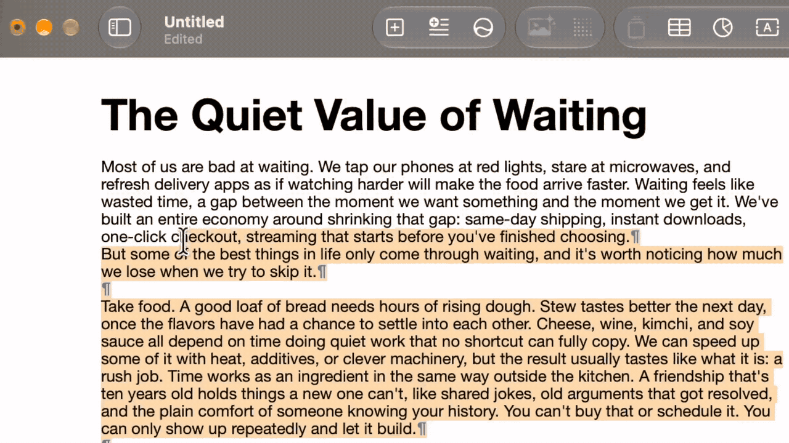

  

<h1 align="center">Shrink</h1>

<strong>Private, on-device summaries for your Mac.</strong>

<a href="https://apps.apple.com/us/app/shrink-local-ai-summarizer/id6819268354?mt=12">Get It Here For Free!</a>

---

## What does Shrink do?

An on-device text summarizer for macOS. Select text in almost any app, and Shrink summarizes it with Apple Intelligence.

## Why Shrink?

Ever since the removal of Writing Tools in macOS 27, there's been no quick way to summarize the text you're reading. Shrink brings it back, and keeps it simple: press a shortcut in almost any app, or right-click in Safari, and the summary appears right where you are.

Everything runs on your Mac with Apple Intelligence's on-device model. **Shrink has no internet access and keeps no history of your text or summaries**. Read the full [privacy policy](PRIVACY.md).

It's also **free, with nothing hidden: no subscriptions, trials, in-app purchases, ads or accounts**. With no servers to pay for, there's nothing to charge you for.

## Great! How do I use it?

### In most apps

  

Select text and press **⌃⇧⌘S** (or right-click → **Services → Summarize with Shrink**). A panel opens by the pointer and the summary appears as it's written. Click **Copy** or press **⌘C** to copy it, and **Escape** to close.

### In Safari

  

Select text, right-click, and choose **Summarize with Shrink**. The summary opens under Shrink's **Summarize** button in the toolbar, so keep that button there.

## Requirements & Installation Guide

**Requirements:**

A Mac with Apple Intelligence turned on, running macOS 27 or later.

**Installation:**

1. Download Shrink for free from the [Mac App Store](https://apps.apple.com/us/app/shrink-local-ai-summarizer/id6819268354?mt=12).
2. Open it. Shrink lives in the menu bar, and on first launch a short guide walks you through two one-time switches:
   - **Shortcut and Services menu:** System Settings → Keyboard → **Keyboard Shortcuts…** → Services → Text → tick **Summarize with Shrink**.
   - **Safari extension:** Safari → Settings → Extensions → tick **Shrink**, then allow it on every website (or choose **Always Allow on Every Website** the first time you right-click).

To see the guide again, choose **How to Use Shrink…** from the menu bar icon.

## Supported Languages

English, Danish, Dutch, French, German, Italian, Japanese, Korean, Norwegian, Portuguese (Brazil), Simplified Chinese, Spanish, Swedish, Traditional Chinese, Turkish and Vietnamese, for both summaries and the interface.

## Help

See [Support](SUPPORT.md), or email [shrink.app.support@icloud.com](mailto:shrink.app.support@icloud.com).

---

Apple, Apple Intelligence, App Store, Mac, macOS and Safari are trademarks of Apple Inc., registered in the U.S. and other countries and regions.
